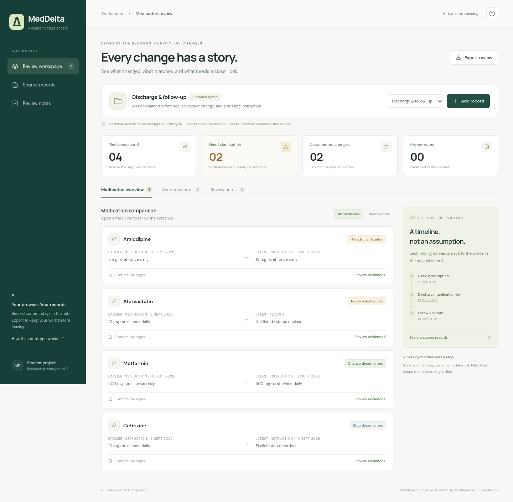

# MedDelta

A working medication-record comparison prototype. Open dated source records, inspect evidence-backed differences, add reviewer notes, and export a JSON report. All record processing happens in the browser; records and notes are held in memory and reset on reload.



**Status:** Working v0.2 prototype with 26 automated behavioral tests, a local action classifier, and a source-linked extraction review workflow. Pharmacist-reviewed validation is still pending.

**Hosted demo:** https://meddelta-review.lakshnagori1508.chatgpt.site (private to the project owner). Everyone with this repository can run the same application locally.

## Run locally

Install Node.js 22 or later, then run:

```sh
git clone https://github.com/laksh150806/MedDelta.git
cd MedDelta
npm start
```

Open http://localhost:3000. No package installation, API key, database, or paid service is needed. The hosted copy uses private Sites access. Google Fonts is an optional presentation dependency; system fonts are the fallback.

## Test

```sh
npm test
```

## What works

- Four fictional sample cases and editable dated records.
- Import of plain-text files (up to 60 KB / 15,000 characters).
- A strict parser plus expanded extraction using a local action classifier and field rules.
- A review screen to correct and explicitly confirm expanded extracted fields.
- Source-linked extraction history, reviewer identity, and timestamps.
- Chronological comparison with exact source text and line numbers.
- Explicit changes, unexplained conflicts, omissions, matching instructions, and explicit stops.
- Per-medicine review notes and a complete JSON export.
- Unsupported lines remain visible and make the comparison provisional.

## Important scope

This combines a deterministic comparison engine with a small action classifier trained on synthetic phrases. **It is not a clinically validated product or a general medical AI.** It does not diagnose, choose treatment, check interactions, establish a current medication list, or tell someone what medication to take. Fictional examples are not prescribing guidance.

The parser supports one instruction per line, for example:

```text
Continue Metformin 500 mg orally once daily.
Change Metformin 500 mg orally twice daily.
Stop Cetirizine.
```

Matching uses the exact normalized medicine name, not brand-to-ingredient resolution. Written amounts are not automatically classified as strength or administered dose. Expanded wording such as `Please increase Metformin to 500 mg by mouth twice a day.` can be reviewed using **Source records → Review extraction**. Expanded suggestions do not enter the comparison until the reviewer confirms them. Qualifiers outside the supported grammar are rejected rather than discarded. Missing route information remains unspecified. Document dates order evidence; clinical effective dates are not inferred. A later instruction does not automatically resolve an earlier conflict. Reviewer notes do not modify the original findings or certify safety.

Use only fictional or appropriately de-identified records. Exported files contain source text and notes. There is no server-side patient database or analytics. The site host still receives ordinary page requests.

## Architecture

- `dist/engine.js`: pure parsing and temporal-comparison functions, sample cases.
- `dist/app.js`: browser workflow, extraction review, evidence panels, editing, notes, exports.
- `dist/extraction.js`, `dist/review.js`: suggestions, field validation, and review provenance.
- `dist/classifier.js`, `dist/action-model.js`: local model inference and exported weights.
- `scripts/train_action_model.py`: optional model training.
- `scripts/evaluate.mjs`: reproducible synthetic development evaluation.
- `dist/index.html`, `dist/styles.css`: responsive interface.
- `tests/engine.test.js`: core behavioral checks.
- `server.js`: dependency-free development server.

## Next research milestone

Use the project brief to establish a pharmacist-reviewed annotation rubric and separate development/evaluation cases. Compare the extraction pipeline with expanded-rule and language-model baselines, and measure unsupported conclusions as well as coverage. OCR and broader medication matching are future work, not features in this release.

See [PROJECT_BRIEF.md](PROJECT_BRIEF.md) for scope, evaluation design, prior work, and the semester plan.


## Model and evaluation

The included model runs locally with no paid service. To reproduce the development evaluation:

```sh
npm run evaluate
npm run evaluate:check
```

Optional retraining (Python 3.11+):

```sh
python -m pip install -r requirements-training.txt
python scripts/train_action_model.py
npm test
npm run evaluate
```

Read [the model card](docs/MODEL_CARD.md) before interpreting the results. The small synthetic benchmark exercises supported constructions; its scores do not establish real-world or clinical performance.
